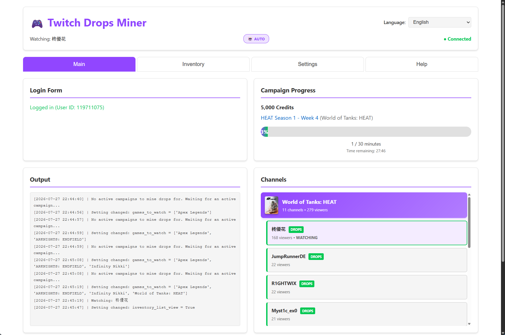

# Twitch Drops Miner

Automatically earn timed Twitch Drops without downloading stream video or audio.
Mining reads playlist metadata and checks segment response headers to keep bandwidth low.

<p align="center">
  <a href="https://github.com/rangermix/TwitchDropsMiner/stargazers"></a>
  <a href="https://github.com/rangermix/TwitchDropsMiner/releases"></a>
  <a href="https://hub.docker.com/r/rangermix/twitch-drops-miner"></a>
  <a href="https://github.com/rangermix/TwitchDropsMiner/blob/main/LICENSE"></a>
  <a href="https://www.python.org/downloads/"></a>
</p>

TDM discovers eligible campaigns, selects live channels, and tracks and claims rewards
from a web dashboard. Run it on your own computer or home server. This hobby project
supports personal use on your own hardware and home network; third-party hosting and
services operated for other users are outside its support scope.



- Choose and prioritize games, or let TDM discover available campaigns.
- [Mine other eligible games as fallback](docs/usage.md#choose-games-and-priorities)
  while preserving your saved priority list.
- [Reorder the wanted queue on Main](docs/usage.md#change-the-queue-order-temporarily)
  until restart, without changing your saved Mining list. Channel selection follows
  this order among campaigns the channel can earn.
- Track campaigns and rewards, and ignore drops you do not want.
- Skip channels while Twitch reports an active ban, including temporary bans.
- Sign in inside the dashboard; TDM saves and renews your session automatically.
- Review claimed-drop history, export it to CSV, and receive Telegram or Discord notifications.
  Discord claim alerts include reward artwork when available.
- Manage everything from a web dashboard with optional password protection.
- Set daily [mining hours](docs/usage.md#mining-hours) in the miner’s local timezone.
- [Pause mining](docs/usage.md#pause-mining) for 10 minutes, an hour, until tomorrow,
  or until you resume, for example while you watch Twitch yourself. Fixed durations
  use elapsed time; tomorrow means the miner's next local midnight. Restarting TDM
  clears the pause, and already-earned rewards can still be claimed while paused.
  Reconnecting to the same running miner keeps its latest pause state.

Invalid settings or a failed save keep your previous settings unchanged.

In v2.4.0, Settings groups controls into **General**, **Mining**, **Games**,
**Notifications**, and **Account & Maintenance**. The **Pause** menu stops watching
temporarily; it resets on restart and leaves earned reward claims available.

The redesigned dashboard's **Now Watching** card offers **Show thumbnail**, off on
each page load. When enabled, it shows a Twitch JPEG thumbnail, refreshed on channel
updates at most once per minute. It does not play video or audio. The header adapts to
longer translations, grouping account controls and navigation on smaller screens.
Hover over shortened account or renewal text to read it in full. This dashboard change
is included in the published releases.

Inventory has expandable campaigns, card/list view buttons and **Add to mining list** for linked games
not yet selected. Campaign details appear once, with matching linked/unlinked card layouts.
It supports **All / Linked / Not Linked** account-link filters. **Settings → Mining** has a
default-off option to mine campaigns reported as Not Linked; read its warning and
check Twitch progress. See the [dashboard guide](docs/usage.md#account-link-override).

**Settings → Games → Mining list** marks each game as **LINKED** or **NOT LINKED** from your
inventory, lists linked games first in **Available Games**, can filter by link status,
and offers **Select Linked** to add every linked game at once. Selection controls wrap
on narrow screens. See
[Choose games and priorities](docs/usage.md#choose-games-and-priorities).

TDM ignores progress-poll responses superseded by newer campaign observations
or inventory reloads. Fresh Twitch readings can still correct local progress.

Use **Settings → Account & Maintenance → Dump diagnosis data** for bug reports. It saves
deidentified miner state and recent sanitized API responses in your data volume;
see [diagnosis data](docs/troubleshooting.md#save-diagnosis-data).

TDM checks active Drop progress about once a minute while successfully watching,
including when a reward still has substantial watch time remaining.

## Quick start

With Docker installed, choose one setup below. Shell examples use Bash
(Linux, macOS, or WSL).

### Docker run

Pull and start the published image:

```bash
docker pull rangermix/twitch-drops-miner:2.4.0
docker run -d \
  --name twitch-drops-miner --init --stop-timeout 30 --shm-size 256m \
  -p 8080:8080 -e TZ=Australia/Sydney \
  -v "${PWD}/data:/app/data" \
  --restart unless-stopped \
  rangermix/twitch-drops-miner:2.4.0
```

### Docker Compose

For a new installation, create a dedicated folder and save this as `compose.yaml`
inside it. Set `TZ` to your home internet connection's timezone:

```yaml
services:
  twitch-drops-miner:
    image: rangermix/twitch-drops-miner:2.4.0
    container_name: twitch-drops-miner
    init: true
    stop_grace_period: 30s
    shm_size: 256m
    ports:
      - "8080:8080"
    volumes:
      - ./data:/app/data
      - ./logs:/app/logs
    environment:
      TZ: Australia/Sydney
    restart: unless-stopped
```

From that folder, pull and start the image:

```bash
docker compose pull && docker compose up -d
```

For either setup, open <http://localhost:8080>, or `http://YOUR-SERVER:8080` from
another device on your home network. Host names not covered by the
[allowed host names](docs/dashboard-access.md#allowed-host-names) need `ALLOWED_HOSTS`.
The `PUBLIC_BASE_URL` host needs no extra entry, even if it ends in a dot.
Keep the `data` directory when updating.
For Compose management, source builds, and switching an existing installation to
Compose, see the [installation guide](docs/installation.md#docker-compose).
For source security rebuilds with refreshed base images and packages, see the
[build instructions](docs/installation.md#docker).

## Sign in

1. Open the dashboard. When Twitch login is required, TDM shows its container browser
   and the Twitch sign in page automatically.
2. Sign in and complete Twitch verification. The browser closes automatically a few
   seconds after login; **Finish sign in** remains available if it stays open.
   Password saving is disabled. Expand **Copy and paste** to transfer text to or from the browser.
3. TDM verifies your account and campaign access, saves the session, and returns to
   the normal dashboard. Select your games there.

You can close and reopen the dashboard tab during sign in; the container browser
keeps running until the attempt finishes or times out.

Set Docker’s `TZ` to match your home internet connection’s timezone; change
`Australia/Sydney` in the example as needed. Chromium and the temporary display are
included in the image. Your everyday browser profile is separate.
TDM renews the session automatically using a private verification browser, separate
from the sign-in viewer. On Linux/macOS, v2.4.0 uses a private pipe for this browser's
control connection; Windows uses loopback. See [session renewal](docs/authentication.md).
**Settings → Account & Maintenance → Log out of Twitch** clears this miner’s session
and opens sign in again for account replacement.
See [authentication](docs/authentication.md) and [troubleshooting](docs/troubleshooting.md).
If Twitch rejects the embedded browser, select **Use desktop helper** and run the
matching Windows, Linux, or macOS helper with your dashboard address. The first helper
to connect is accepted during a ten-minute window; no pairing code is needed.
See [desktop helper downloads and steps](docs/authentication.md#desktop-helper-fallback).
HTTPS verification is on by default. For a self-signed dashboard certificate, source
helpers accept `--ca-file`, or can opt out with `--insecure` (unsafe); neither is in
v2.4.0 downloads. See [helper HTTPS](docs/authentication.md#helper-https-certificates).
For rejected helper logins, report the fixed error code and a redacted miner log;
see [helper diagnostics](docs/troubleshooting.md#helper-login-error-codes).

Keep session data directories private. On Windows, credential files inherit the
directory's access permissions (ACLs); Unix file-mode numbers do not verify those
permissions. On Linux/macOS, session files use owner-only permissions.

## Updating Docker

### With docker run

For the `docker run` setup above, run this from the **same folder** so `${PWD}/data`
still points to your existing data. Keep your own timezone and any custom container
name, ports, mounts, or environment options when adapting the commands.
Review the [release notes](https://github.com/rangermix/TwitchDropsMiner/releases) first.

```bash
docker pull rangermix/twitch-drops-miner:latest &&
docker stop --timeout 30 twitch-drops-miner &&
docker rm twitch-drops-miner &&
docker run -d \
  --name twitch-drops-miner --init --stop-timeout 30 --shm-size 256m \
  -p 8080:8080 -e TZ=Australia/Sydney \
  -v "${PWD}/data:/app/data" \
  --restart unless-stopped \
  rangermix/twitch-drops-miner:latest
```

This replaces the container while keeping the mounted data. `latest` selects the
current stable image when you pull; it does not update automatically. To choose a
specific release, replace `latest` in both places with its version tag.

### With Docker Compose

For the published-image setup above, change the `image:` tag in `compose.yaml` to
the release you want, or use `latest`. From the folder containing that file, run:

```bash
docker compose pull && docker compose up -d
```

For the repository's source-building `docker-compose.yml`, run this from your
original Git clone on the branch you intend to update:

```bash
git pull --ff-only && docker compose up -d --build
```

This builds that branch's source, which may be newer than the published release, and
reuses the configured data/log mounts. For named volumes, custom Compose files, and
backup guidance, see [detailed update steps](docs/installation.md#persistent-data-and-upgrades).

## Upgrading to v2.0

Keep your existing `data` directory, including `cookies.jar`, and the same Docker volume.
A working Android session is restored automatically. If you used the Smart TV login in
v1.3.1/v1.3.2, your session has expired, or you are signed out, sign in using the dashboard browser. Follow the [v2.0 migration steps](https://github.com/rangermix/TwitchDropsMiner/releases/tag/v2.0.0)
when updating your container or source installation.

## User guides

Browse the [GitHub wiki](https://github.com/rangermix/TwitchDropsMiner/wiki) or read the
same guides in [docs](docs/README.md):

- [Installation and updates](docs/installation.md)
- [Login, migration, and recovery](docs/authentication.md)
- [Games, campaigns, inventory, and history](docs/usage.md)
- [Dashboard password and reverse proxies](docs/dashboard-access.md)
- [Telegram and Discord notifications](docs/notifications.md)
- [Troubleshooting](docs/troubleshooting.md)

## Help and contributions

Search [existing issues](https://github.com/rangermix/TwitchDropsMiner/issues) before
reporting a problem. Use the [bug-report form](https://github.com/rangermix/TwitchDropsMiner/issues/new?template=bug_report.yml)
with the running app version, hosting environment, reproduction steps, and redacted evidence.
See [CONTRIBUTING.md](CONTRIBUTING.md) for bug reports, translations,
and development. CI lint checks validate source without rewriting it. Source checkouts
containing the launcher fix preserve renewal control pipes through display wrappers
that use low descriptors.
This fork uses AI-assisted development with automated checks and
independent review. Agents acknowledge work in the relevant issue or PR before starting
and post the outcome there when work ends or pauses.

Visual dashboard PRs require redacted screenshots, with before/after views when an
existing screen changes; see [contribution guidance](CONTRIBUTING.md#5-submit-clear-evidence-and-follow-through).

Based on [DevilXD/TwitchDropsMiner](https://github.com/DevilXD/TwitchDropsMiner).
See [credits](docs/credits.md) for the original project and translation contributors.
You can support this fork by [starring it](https://github.com/rangermix/TwitchDropsMiner)
or [buying the maintainer a coffee](https://buymeacoffee.com/rangermix).

## Contributors

<details>
<summary>People who contributed merged pull requests</summary>

<!-- contributors:start -->
| Contributor | Merged pull requests |
| --- | --- |
| [@0zLloen](https://github.com/0zLloen) | [#152](https://github.com/rangermix/TwitchDropsMiner/pull/152) · [#185](https://github.com/rangermix/TwitchDropsMiner/pull/185) · [#191](https://github.com/rangermix/TwitchDropsMiner/pull/191) · [#188](https://github.com/rangermix/TwitchDropsMiner/pull/188) · [#192](https://github.com/rangermix/TwitchDropsMiner/pull/192) · [#193](https://github.com/rangermix/TwitchDropsMiner/pull/193) · [#194](https://github.com/rangermix/TwitchDropsMiner/pull/194) · [#186](https://github.com/rangermix/TwitchDropsMiner/pull/186) · [#189](https://github.com/rangermix/TwitchDropsMiner/pull/189) · [#175](https://github.com/rangermix/TwitchDropsMiner/pull/175) · [#176](https://github.com/rangermix/TwitchDropsMiner/pull/176) · [#202](https://github.com/rangermix/TwitchDropsMiner/pull/202) · [#200](https://github.com/rangermix/TwitchDropsMiner/pull/200) · [#201](https://github.com/rangermix/TwitchDropsMiner/pull/201) · [#204](https://github.com/rangermix/TwitchDropsMiner/pull/204) |
| [@3lb0z0](https://github.com/3lb0z0) | [#110](https://github.com/rangermix/TwitchDropsMiner/pull/110) |
| [@andreluisfc](https://github.com/andreluisfc) | [#76](https://github.com/rangermix/TwitchDropsMiner/pull/76) |
| [@birdhimself](https://github.com/birdhimself) | [#41](https://github.com/rangermix/TwitchDropsMiner/pull/41) |
| [@brk275](https://github.com/brk275) | [#171](https://github.com/rangermix/TwitchDropsMiner/pull/171) · [#172](https://github.com/rangermix/TwitchDropsMiner/pull/172) · [#179](https://github.com/rangermix/TwitchDropsMiner/pull/179) |
| [@capkz](https://github.com/capkz) | [#70](https://github.com/rangermix/TwitchDropsMiner/pull/70) |
| [@Dolverin](https://github.com/Dolverin) | [#142](https://github.com/rangermix/TwitchDropsMiner/pull/142) |
| [@EthanBlazkowicz](https://github.com/EthanBlazkowicz) | [#33](https://github.com/rangermix/TwitchDropsMiner/pull/33) |
| [@Klages](https://github.com/Klages) | [#94](https://github.com/rangermix/TwitchDropsMiner/pull/94) · [#95](https://github.com/rangermix/TwitchDropsMiner/pull/95) · [#183](https://github.com/rangermix/TwitchDropsMiner/pull/183) |
| [@Knight-sys](https://github.com/Knight-sys) | [#3](https://github.com/rangermix/TwitchDropsMiner/pull/3) |
| [@rangermix](https://github.com/rangermix) | [#1](https://github.com/rangermix/TwitchDropsMiner/pull/1) · [#2](https://github.com/rangermix/TwitchDropsMiner/pull/2) · [#7](https://github.com/rangermix/TwitchDropsMiner/pull/7) · [#8](https://github.com/rangermix/TwitchDropsMiner/pull/8) · [#9](https://github.com/rangermix/TwitchDropsMiner/pull/9) · [#13](https://github.com/rangermix/TwitchDropsMiner/pull/13) · [#20](https://github.com/rangermix/TwitchDropsMiner/pull/20) · [#24](https://github.com/rangermix/TwitchDropsMiner/pull/24) · [#29](https://github.com/rangermix/TwitchDropsMiner/pull/29) · [#32](https://github.com/rangermix/TwitchDropsMiner/pull/32) · [#45](https://github.com/rangermix/TwitchDropsMiner/pull/45) · [#74](https://github.com/rangermix/TwitchDropsMiner/pull/74) · [#79](https://github.com/rangermix/TwitchDropsMiner/pull/79) · [#80](https://github.com/rangermix/TwitchDropsMiner/pull/80) · [#84](https://github.com/rangermix/TwitchDropsMiner/pull/84) · [#86](https://github.com/rangermix/TwitchDropsMiner/pull/86) · [#88](https://github.com/rangermix/TwitchDropsMiner/pull/88) · [#93](https://github.com/rangermix/TwitchDropsMiner/pull/93) · [#89](https://github.com/rangermix/TwitchDropsMiner/pull/89) · [#90](https://github.com/rangermix/TwitchDropsMiner/pull/90) · [#91](https://github.com/rangermix/TwitchDropsMiner/pull/91) · [#92](https://github.com/rangermix/TwitchDropsMiner/pull/92) · [#104](https://github.com/rangermix/TwitchDropsMiner/pull/104) · [#105](https://github.com/rangermix/TwitchDropsMiner/pull/105) · [#116](https://github.com/rangermix/TwitchDropsMiner/pull/116) · [#119](https://github.com/rangermix/TwitchDropsMiner/pull/119) · [#120](https://github.com/rangermix/TwitchDropsMiner/pull/120) · [#124](https://github.com/rangermix/TwitchDropsMiner/pull/124) · [#125](https://github.com/rangermix/TwitchDropsMiner/pull/125) · [#126](https://github.com/rangermix/TwitchDropsMiner/pull/126) · [#127](https://github.com/rangermix/TwitchDropsMiner/pull/127) · [#131](https://github.com/rangermix/TwitchDropsMiner/pull/131) · [#133](https://github.com/rangermix/TwitchDropsMiner/pull/133) · [#145](https://github.com/rangermix/TwitchDropsMiner/pull/145) · [#146](https://github.com/rangermix/TwitchDropsMiner/pull/146) · [#149](https://github.com/rangermix/TwitchDropsMiner/pull/149) · [#153](https://github.com/rangermix/TwitchDropsMiner/pull/153) · [#154](https://github.com/rangermix/TwitchDropsMiner/pull/154) · [#159](https://github.com/rangermix/TwitchDropsMiner/pull/159) · [#160](https://github.com/rangermix/TwitchDropsMiner/pull/160) · [#161](https://github.com/rangermix/TwitchDropsMiner/pull/161) · [#164](https://github.com/rangermix/TwitchDropsMiner/pull/164) · [#167](https://github.com/rangermix/TwitchDropsMiner/pull/167) · [#169](https://github.com/rangermix/TwitchDropsMiner/pull/169) · [#203](https://github.com/rangermix/TwitchDropsMiner/pull/203) |
| [@Sean-Destefano](https://github.com/Sean-Destefano) | [#49](https://github.com/rangermix/TwitchDropsMiner/pull/49) |
| [@SimpliAj](https://github.com/SimpliAj) | [#72](https://github.com/rangermix/TwitchDropsMiner/pull/72) |
| [@Stein-N](https://github.com/Stein-N) | [#71](https://github.com/rangermix/TwitchDropsMiner/pull/71) |
| [@vurmil](https://github.com/vurmil) | [#12](https://github.com/rangermix/TwitchDropsMiner/pull/12) · [#17](https://github.com/rangermix/TwitchDropsMiner/pull/17) · [#18](https://github.com/rangermix/TwitchDropsMiner/pull/18) · [#100](https://github.com/rangermix/TwitchDropsMiner/pull/100) · [#150](https://github.com/rangermix/TwitchDropsMiner/pull/150) · [#102](https://github.com/rangermix/TwitchDropsMiner/pull/102) · [#101](https://github.com/rangermix/TwitchDropsMiner/pull/101) |
<!-- contributors:end -->

</details>

**Settings → Mining → Reward types** chooses which reward types to mine and, optionally, drag
them into a preferred order; earlier reward deadlines break ties. Position fields also
support keyboard editing; Tab moves normally while changes save, and settings updates
keep your chosen reward or game control focused.
[Reward types](docs/usage.md#reward-types) explains the ordering.

The sign-in page also offers an advanced existing-session token option. See the
[authentication guide](docs/authentication.md) for clipboard controls and recovery.
